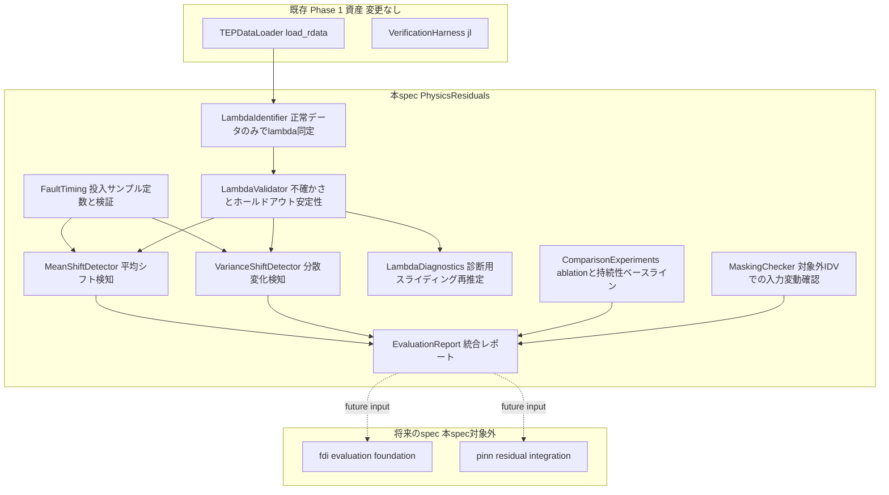
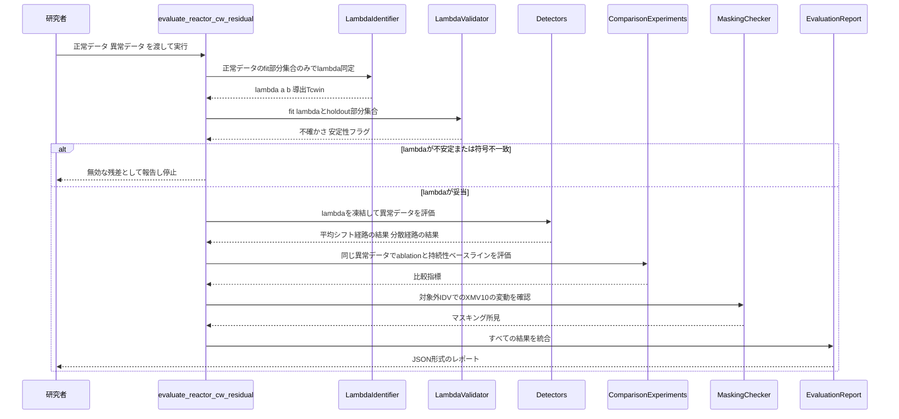
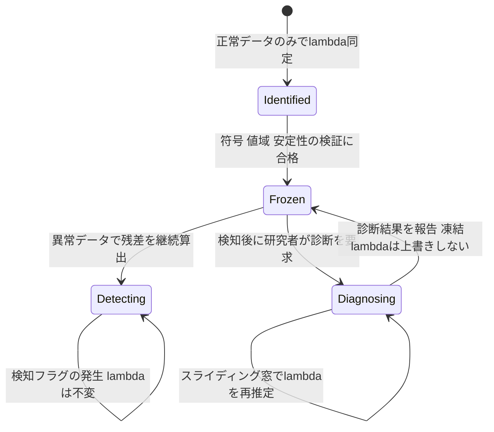

# Design Document: reactor-cw-energy-residual

## Overview

反応器冷却水のエネルギー収支について、操作量（XMV(10)）を含む物理収支残差 $r = k\,u_{10}(T_{cw,out}-T_{cw,in}) - UA(T_r-T_{cw,out})$ を実装する。この式は$UA$で両辺を割ることで、未知パラメータ$\lambda=\{a=k/UA,\ b=-a\cdot T_{cw,in}\}$について線形な回帰 $y = a\,x_1 + b\,x_2$（$y=T_r-T_{cw,out}$、$x_1=u_{10}T_{cw,out}$、$x_2=u_{10}$）として同定する。

**Users**: このプロジェクトの研究者（本人）が、Juliaスクリプトとして直接呼び出し、IDV(4)/(11)/(14)に対する検知性能を評価する。

**Impact**: 新規モジュール`src/PhysicsResiduals/`を追加する。既存のPhase 1資産（`VerificationHarness.jl`等）は変更しない。

### Goals
- $\lambda$を正常データのみで同定し、物理的妥当性（符号・値域）を機械的に検証する
- 凍結した$\lambda$で、平均シフト型（IDV4）と分散変化型（IDV11/14）の両方の故障を検知する
- 操作量ablationと持続性ベースラインとの比較により、残差モデルの価値を定量的に示す
- 検知できなかった場合・マスキングの疑いがある場合を、誠実に記録する

### Non-Goals
- PCAベースライン・パーセンタイル閾値方針の確立（`fdi-evaluation-foundation`）
- 複数残差の統合・故障箇所の帰属性判定（`fdi-evaluation-foundation`）
- ニューラルネットワーク/PINNの導入（`pinn-residual-integration`）
- LLMによる新しい残差構造の提案（`llm-residual-proposer`）
- 既存の`VerificationHarness.jl`・Phase 1の確定済み結果（XMEAS(7)等）への変更

## Boundary Commitments

### This Spec Owns
- 反応器冷却水エネルギー収支残差の式・$\lambda$同定・凍結・診断ロジック（`src/PhysicsResiduals/ReactorCwEnergyResidual.jl`）
- この残差に関する検知評価（IDV4/11/14の平均シフト型・分散変化型の両統計量）とレポート出力
- 故障投入時刻の正しい定数（サンプル21）とそれを用いたラン境界尊重の評価ロジック。このロジックは本spec用に実装するが、後続specが同じ定数を再利用できるよう独立した小さなユーティリティとして切り出す
- TEPデータセットのサンプリング仕様（3分間隔・投入サンプル21）を記録する最小限のドキュメント（`docs/dataset_spec.md`）

### Out of Boundary
- `VerificationHarness.jl`自体の修正（投入時刻バグを含む）。Phase 1の既存呼び出し元への影響を避けるため、本specでは触れない
- 複数残差の統合評価、PCA比較、パーセンタイル閾値ロジックの実装
- `baselines/`・`pinn/`ディレクトリの作成（それぞれ`fdi-evaluation-foundation`・`pinn-residual-integration`が担当）
- `tep-data-loader`specのrequirements/design自体の更新（roadmap.mdのExisting Spec Updatesに記録済み、別途対応）

### Allowed Dependencies
- `src/TEPDataLoader.jl`の`load_rdata`（データロード、変更せず利用）
- Julia標準ライブラリ：`Statistics`、`LinearAlgebra`、`Random`
- 既存の`Project.toml`に登録済みの`DataFrames`・`JSON`（新規パッケージ追加なし）
- 正常データ・異常データの`.RData`ファイル（既存、プロジェクトルート）

### Revalidation Triggers
- `fdi-evaluation-foundation`が閾値決定方針（99パーセンタイル等）を確立した場合、本specのRequirement 4.3/5.3の暫定しきい値規約（FIT残差最大×1.25）を再評価する必要がある
- `condenser-cw-energy-residual`（2本目の同型残差spec）に着手する際、本specとのコード重複が顕在化すれば、共通部分の抽出を検討する
- 故障投入サンプル定数（21）を使う後続specが増えた場合、本specが所有する`FaultTiming`ユーティリティの所有権を見直す

## Architecture

### Existing Architecture Analysis
- `src/VerificationHarness.jl`は$\Delta y(t)=y(t)-y(t-1)$の差分予測専用に設計されており、本specの代数的残差（同時刻の関係式）には適用できない（詳細は`research.md`参照）
- `src/NumericalEvaluator/linear_fit.jl`はLLM生成式の線形性を数値的に検証してからOLSを行う汎用関数だが、本specの残差は物理的導出から線形であることが自明なため、線形性検証ステップは不要。厳密OLS（`A \ b`）という数値解法のみを踏襲する
- `src/TEPDataLoader.load_rdata`はそのまま再利用する

### Architecture Pattern & Boundary Map



**Architecture Integration**:
- 選択パターン：単一Juliaモジュール内の関数群（マイクロサービス的分割は不要。既存`NumericalEvaluator.jl`・`VerificationHarness.jl`と同じ「薄い集約モジュール + ロジックファイル」パターンを踏襲）
- ドメイン境界：同定（正常データのみ）→凍結→検知（2経路）→診断（分離）→比較→誠実な報告、という責務の流れをそのままモジュール内の関数分離に対応させる
- 既存パターンの維持：ラン境界尊重のfit/holdout分割、MASE（分母をFIT固定）、JSON出力、符号事前宣言という`VerificationHarness.jl`/`variable-modeling-methodology.md`の規律
- 新規コンポーネントの理由：残差の目的変数形式が既存ハーネスと根本的に異なるため（research.md参照）
- Steering整合性：CLAUDE.md §2（操作量必須・制御則除外）、§3（$\lambda$正常データ限定同定・凍結）、§8（学術的誠実さ）を満たす

### Technology Stack

| Layer | Choice / Version | Role in Feature | Notes |
|-------|------------------|-----------------|-------|
| 言語/ランタイム | Julia 1.10.4（既存） | $\lambda$同定・検知・診断ロジック全体 | 新規依存なし |
| データロード | `RData.jl`（既存、`TEPDataLoader`経由） | `.RData`ファイルの読み込み | 変更なし |
| 数値計算 | `LinearAlgebra`標準ライブラリ | 厳密OLS（`A \ b`） | `linear_fit.jl`と同じ数値解法 |
| 統計計算 | `Statistics`標準ライブラリ | 平均・標準偏差・分位点（ブートストラップCI） | 新規依存なし |
| 出力形式 | `JSON.jl`（既存） | 評価レポートのJSON出力 | `VerificationHarness.jl`と同じ規約 |

## File Structure Plan

### Directory Structure
```
src/
└── PhysicsResiduals/
    ├── PhysicsResiduals.jl          # 薄い集約モジュール(includeのみ、NumericalEvaluator.jlと同型)
    └── ReactorCwEnergyResidual.jl   # 本spec固有ロジック全体(式定義・λ同定・検知・診断・比較・誠実さ報告)
docs/
└── dataset_spec.md                   # 新規: サンプリング間隔(3分)・故障投入サンプル(21)の単一の情報源
test/
└── PhysicsResiduals/
    └── runtests.jl                   # 新規テスト(test/VerificationHarness/runtests.jlと同型)
```

> `ReactorCwEnergyResidual.jl`を単一ファイルとした理由は`research.md`のDesign Decisions参照（現時点で実装対象は本spec1本分のみであり、複数ファイルへの分割は先回りの抽象化に当たるため）。

### コンポーネント→ファイルの対応

Components and Interfacesで定義した10コンポーネントは、以下のようにファイルへ対応する（すべて新規ファイルで、既存ファイルへの変更はない）。

| コンポーネント | 配置ファイル |
|---|---|
| ResidualFormula, FaultTiming, LambdaIdentifier, LambdaValidator, MeanShiftDetector, VarianceShiftDetector, LambdaDiagnostics, ComparisonExperiments, MaskingChecker, EvaluationReport | `src/PhysicsResiduals/ReactorCwEnergyResidual.jl`（1ファイルに関数群として実装） |
| （モジュール集約のみ、コンポーネントなし） | `src/PhysicsResiduals/PhysicsResiduals.jl` |
| （データ仕様ドキュメント、コンポーネントなし） | `docs/dataset_spec.md` |
| （上記10コンポーネントのテスト） | `test/PhysicsResiduals/runtests.jl` |

### Modified Files
なし（既存ファイルへの変更は行わない）。

## System Flows

### 評価パイプライン（同定〜検知〜報告）



### 検知（凍結）と診断（再推定）の分離



**キー判断**: 検知用の凍結$\lambda$と診断用の再推定$\lambda$は、常に別々の変数として保持される（Requirement 6.3）。診断は検知パイプラインの outcome に影響を与えない。

## Requirements Traceability

| Requirement | Summary | Components | Interfaces | Flows |
|---|---|---|---|---|
| 1.1 | 残差を線形な$\lambda$の回帰として表現 | ResidualFormula | `build_design_matrix` | 評価パイプライン |
| 1.2 | $\lambda$の符号・値域の事前宣言 | ResidualFormula | `LAMBDA_SIGN_CONSTRAINTS`定数 | 評価パイプライン |
| 1.3 | 符号不一致時に無効フラグ | LambdaIdentifier | `identify_lambda` | 評価パイプライン(alt分岐) |
| 1.4 | $T_{cw,in}$の物理的妥当性チェック | LambdaIdentifier | `check_physical_plausibility` | 評価パイプライン(alt分岐) |
| 1.5 | 準定常仮定が不十分な場合の動的項追加 | ResidualFormula | `assess_quasi_steady_adequacy` | 評価パイプライン |
| 1.6 | $k$/$UA$の個別同定不可能性の明記 | ResidualFormula | ドキュメントコメント + レポート出力 | — |
| 2.1 | 異常データを同定に使わない | LambdaIdentifier | `identify_lambda`（入力は正常データのみ） | 評価パイプライン |
| 2.2 | fit/holdoutの分割（重複なし） | LambdaIdentifier | `split_normal_data` | 評価パイプライン |
| 2.3 | 閾値決定にも異常データを使わない | MeanShiftDetector, VarianceShiftDetector | `calibrate_threshold` | 評価パイプライン |
| 3.1 | 不確かさの推定値の報告 | LambdaValidator | `bootstrap_lambda_uncertainty` | 評価パイプライン |
| 3.2 | holdoutでの再評価と範囲内判定 | LambdaValidator | `check_holdout_stability` | 評価パイプライン |
| 3.3 | 不安定時のフラグ | LambdaValidator | `check_holdout_stability`の戻り値 | 評価パイプライン(alt分岐) |
| 4.1-4.5 | 平均シフト型検知(IDV4) | MeanShiftDetector | `detect_mean_shift`, `evaluate_fault_detection` | 評価パイプライン |
| 5.1-5.4 | 分散変化型検知(IDV11/14) | VarianceShiftDetector | `detect_variance_shift`, `evaluate_fault_detection` | 評価パイプライン |
| 6.1-6.3 | 診断用$\lambda$再推定 | LambdaDiagnostics | `diagnose_sliding_window` | 診断フロー(状態図) |
| 7.1-7.3 | ablationと持続性ベースライン比較 | ComparisonExperiments | `evaluate_pv_only_variant`, `evaluate_persistence_baseline` | 評価パイプライン |
| 8.1-8.3 | 投入時刻とラン境界の正しい処理 | FaultTiming | `FAULT_INJECTION_SAMPLE`, `verify_injection_timing`, `respects_run_boundary` | 評価パイプライン |
| 9.1-9.3 | 誠実さの記録 | MaskingChecker, EvaluationReport | `check_masking_risk`, `assemble_report` | 評価パイプライン |

## Components and Interfaces

| Component | Domain/Layer | Intent | Req Coverage | Key Dependencies (P0/P1) | Contracts |
|---|---|---|---|---|---|
| ResidualFormula | 物理式 | 残差式の構造・$\lambda$制約を定義 | 1.1-1.6 | なし(P0) | State |
| FaultTiming | データ正確性 | 投入時刻定数とラン境界ユーティリティ | 8.1-8.3 | TEPDataLoader(P0) | State |
| LambdaIdentifier | 同定 | 正常データのみで$\lambda$を同定 | 2.1-2.3, 1.3-1.4 | ResidualFormula(P0) | Service |
| LambdaValidator | 検証 | 不確かさ・安定性を評価 | 3.1-3.3 | LambdaIdentifier(P0) | Service |
| MeanShiftDetector | 検知 | 平均シフト型故障の検知 | 4.1-4.5 | LambdaValidator(P0), FaultTiming(P0) | Service |
| VarianceShiftDetector | 検知 | 分散変化型故障の検知 | 5.1-5.4 | LambdaValidator(P0), FaultTiming(P0) | Service |
| LambdaDiagnostics | 診断 | 検知後のスライディング$\lambda$再推定 | 6.1-6.3 | ResidualFormula(P0) | Service |
| ComparisonExperiments | 評価 | ablation・持続性ベースライン比較 | 7.1-7.3 | LambdaIdentifier(P0), FaultTiming(P1) | Service |
| MaskingChecker | 誠実さ | 対象外IDVでの入力変動確認 | 9.2 | FaultTiming(P1) | Service |
| EvaluationReport | 出力 | 全結果をJSONレポートに統合 | 9.1, 9.3 | 上記すべて(P0) | Batch |

### 物理式・同定

#### ResidualFormula

| Field | Detail |
|-------|--------|
| Intent | 反応器冷却水エネルギー収支残差を、$\lambda$について線形な2パラメータ回帰として表現する |
| Requirements | 1.1, 1.2, 1.5, 1.6 |

**Responsibilities & Constraints**
- 目的変数 $y=T_r-T_{cw,out}$（XMEAS(9) − XMEAS(21)）と、説明変数 $x_1=u_{10}T_{cw,out}$、$x_2=u_{10}$（$u_{10}$=XMV(10)）を構築する
- $\lambda=\{a,b\}$の期待符号（$a>0$, $b<0$）を定数として保持する
- 準定常（代数式）仮定の妥当性を、正常データ上の残差が系統的な未説明構造を持たないかで評価し、不十分なら$T_{cw,out}$の変化率項を式に追加する
- $k$と$UA$が個別には同定不可能で、比$a=k/UA$のみが同定可能であることをコード内のドキュメントとレポート出力の両方に明記する

**Dependencies**
- Outbound: なし（純粋な式定義）

**Contracts**: State [x]

##### State Management
```julia
struct ResidualFeatures
    y::Vector{Float64}          # Tr - Tcw_out
    x1::Vector{Float64}         # u10 * Tcw_out
    x2::Vector{Float64}         # u10
end

const LAMBDA_SIGN_CONSTRAINTS = (a = (:positive, 0.0), b = (:negative, 0.0))

function build_design_matrix(df::DataFrame; tr_col::Symbol=:xmeas_9, tcw_out_col::Symbol=:xmeas_21,
                              u10_col::Symbol=:xmv_10)::ResidualFeatures
```
- Preconditions: `df`に`tr_col`・`tcw_out_col`・`u10_col`の列が存在する
- Postconditions: 返される3ベクトルは同じ長さで、行の対応関係が保たれている
- Invariants: $y$、$x_1$、$x_2$は常に同じ行インデックス集合に対応する

```julia
function assess_quasi_steady_adequacy(normal_resid::Vector{Float64}; significance::Float64=0.05)::Bool
```
- Preconditions: `normal_resid`は凍結前の正常データに対する残差系列
- Postconditions: `true`なら準定常仮定で十分、`false`なら動的項の追加が必要

**Implementation Notes**
- Integration: `LambdaIdentifier`が本コンポーネントの`build_design_matrix`を呼んで設計行列を得る
- Validation: 列名が存在しない場合は明示的なエラーで停止する（サイレントなNaN伝播を避ける）
- Risks: 動的項を追加する判断（1.5）の具体的な検定方法は実装時に正常データで検証する

### データ正確性

#### FaultTiming

| Field | Detail |
|-------|--------|
| Intent | 故障投入時刻の正しい定数とラン境界を尊重したデータ分割を提供する |
| Requirements | 8.1, 8.2, 8.3 |

**Responsibilities & Constraints**
- Rieth et al. 2017データセットにおける故障投入サンプル（21）を定数として保持する
- 実データに対して、サンプル20以前に逸脱がないことを確認するサニティチェックを提供する
- 異なる`simulationRun`をまたいだ特徴量・残差の計算を防ぐ分割ユーティリティを提供する

**Dependencies**
- Inbound: LambdaIdentifier, MeanShiftDetector, VarianceShiftDetector, ComparisonExperiments — 投入時刻定数とラン境界分割の利用（すべてP0）

**Contracts**: State [x]

##### State Management
```julia
const FAULT_INJECTION_SAMPLE = 21  # Rieth et al. 2017データセット、実測確認済み(research.md参照)

function verify_injection_timing(df_faulty::DataFrame, target_idvs::Vector{Int};
                                  pre_injection_max_sample::Int=20, significance_z::Float64=3.0)::Bool

function respects_run_boundary(df::DataFrame, run_col::Symbol=:simulationRun)::DataFrame
```
- Preconditions: `df_faulty`に`faultNumber`・`simulationRun`・`sample`列が存在する
- Postconditions: `verify_injection_timing`は、`pre_injection_max_sample`以前の全サンプルが正常データの分布から有意に逸脱していなければ`true`を返す
- Invariants: `FAULT_INJECTION_SAMPLE`は実行時に変更されない定数

**Implementation Notes**
- Integration: 評価パイプラインの最初に`verify_injection_timing`を一度実行し、前提が崩れていないことを確認してから本評価に進む
- Validation: サニティチェックが`false`を返した場合は、評価を中断し原因調査を促す
- Risks: 将来のデータセット差し替え時にこの定数が無効になる可能性があるため、サニティチェックを必ず経由させる

### 同定・検証

#### LambdaIdentifier

| Field | Detail |
|-------|--------|
| Intent | 正常データのみを用いて$\lambda$を厳密OLSで同定し、符号・物理的妥当性を検証する |
| Requirements | 2.1, 2.2, 2.3, 1.3, 1.4 |

**Responsibilities & Constraints**
- 入力は正常運転データのみ。異常データへの参照を一切持たない（関数シグネチャレベルで異常データ型を受け取らないことで保証する）
- 正常データを`simulationRun`番号で2分割し（例: run≤400を同定用、run>400を保留用）、重複なく分ける
- 符号制約（`ResidualFormula.LAMBDA_SIGN_CONSTRAINTS`）に反する同定結果、または導出される$T_{cw,in}$が$T_{cw,out}$以上・非現実的な範囲にある結果を無効と判定する

**Dependencies**
- Inbound: ResidualFormula — 設計行列の構築（P0）
- Outbound: LambdaValidator, MeanShiftDetector, VarianceShiftDetector, ComparisonExperiments — 同定された$\lambda$を提供（すべてP0）

**Contracts**: Service [x]

##### Service Interface
```julia
struct ReactorCwLambda
    a::Float64
    b::Float64
    t_cw_in::Float64            # 導出値: -b/a
    valid::Bool                 # 符号・物理妥当性チェックの結果
    invalid_reason::Union{String,Nothing}
end

function split_normal_data(df_normal::DataFrame; fit_run_max::Int=400,
                            run_col::Symbol=:simulationRun)::Tuple{DataFrame,DataFrame}

function identify_lambda(df_fit::DataFrame)::ReactorCwLambda

function check_physical_plausibility(lam::ReactorCwLambda; tcw_out_mean::Float64)::ReactorCwLambda
```
- Preconditions: `identify_lambda`の入力`df_fit`は正常データの同定用部分集合のみ
- Postconditions: `ReactorCwLambda.valid=false`の場合、`invalid_reason`に具体的な理由（符号不一致／物理的不整合のいずれか）が入る
- Invariants: `identify_lambda`は異常データを受け取らない型シグネチャになっている

**Implementation Notes**
- Integration: `ResidualFormula.build_design_matrix`の出力を使って`A \ y`の厳密OLSを実行する（`linear_fit.jl`と同じ数値解法）
- Validation: Requirement 1.3/1.4の符号・物理妥当性チェックをここで実施
- Risks: なし

#### LambdaValidator

| Field | Detail |
|-------|--------|
| Intent | 同定された$\lambda$の不確かさを定量化し、保留データでの安定性を確認する |
| Requirements | 3.1, 3.2, 3.3 |

**Responsibilities & Constraints**
- リサンプリングに基づく信頼区間（既定: 95%）を各$\lambda$要素について算出する。リサンプリングはラン単位で行い、ラン内の時系列相関を壊さない
- 保留部分集合（`split_normal_data`の第2戻り値）で$\lambda$を再同定し、同定時の信頼区間内に収まるかを判定する

**Dependencies**
- Inbound: LambdaIdentifier — 同定済み$\lambda$と保留データ（P0）

**Contracts**: Service [x]

##### Service Interface
```julia
struct LambdaUncertainty
    a_ci::Tuple{Float64,Float64}
    b_ci::Tuple{Float64,Float64}
    t_cw_in_ci::Tuple{Float64,Float64}
end

function bootstrap_lambda_uncertainty(df_fit::DataFrame; n_resamples::Int=200,
                                       confidence::Float64=0.95)::LambdaUncertainty

function check_holdout_stability(lam::ReactorCwLambda, uncertainty::LambdaUncertainty,
                                  df_holdout::DataFrame)::Bool
```
- Preconditions: `df_fit`は`LambdaIdentifier.split_normal_data`の同定用部分集合と同一であること
- Postconditions: `check_holdout_stability`が`false`を返した場合、呼び出し元は$\lambda$を検知用途に採用してはならない

**Implementation Notes**
- Integration: 評価パイプラインは`check_holdout_stability`が`false`の場合、検知フェーズに進まず無効として報告する
- Validation: ラン単位リサンプリング（行単位ではない）により時系列相関を保持する
- Risks: `n_resamples`のデフォルト値は実装時にデータの挙動を見て調整してよい

### 検知

#### MeanShiftDetector

| Field | Detail |
|-------|--------|
| Intent | 凍結$\lambda$のもとで残差の大きさに基づき平均シフト型故障（IDV4）を検知する |
| Requirements | 4.1, 4.2, 4.3, 4.4, 4.5 |

**Responsibilities & Constraints**
- 残差 $|y - (a x_1 + b x_2)|$ を時系列で継続算出する
- しきい値は正常検証データ（保留部分集合）のみから決定する（暫定規約：FIT残差最大×1.25、`research.md`参照）
- `FaultTiming.FAULT_INJECTION_SAMPLE`を基準に検知遅れを計測する

**Dependencies**
- Inbound: LambdaValidator — 検証済み$\lambda$（P0）、FaultTiming — 投入時刻定数（P0）

**Contracts**: Service [x]

##### Service Interface
```julia
struct DetectionMetrics
    fdr_by_idv::Dict{Int,Float64}
    add_by_idv::Dict{Int,Float64}     # 投入時刻(サンプル21)を基準とした検知遅れ(サンプル数)
    far_pct::Float64
end

function calibrate_threshold(lam::ReactorCwLambda, df_normal_holdout::DataFrame;
                              margin::Float64=1.25)::Float64

function detect_mean_shift(lam::ReactorCwLambda, df::DataFrame, threshold::Float64)::Vector{Bool}

function evaluate_fault_detection(lam::ReactorCwLambda, threshold::Float64, df_faulty::DataFrame,
                                   target_idvs::Vector{Int})::DetectionMetrics
```
- Preconditions: `threshold`は`calibrate_threshold`の出力であり、異常データを一切参照していない
- Postconditions: `DetectionMetrics.add_by_idv`の値は`FaultTiming.FAULT_INJECTION_SAMPLE`からの相対値

**Implementation Notes**
- Integration: `VarianceShiftDetector`と並行して呼ばれ、結果は独立に`EvaluationReport`へ渡る
- Validation: Requirement 4.5（誤報率を検知指標と区別して報告）はDetectionMetrics構造体のフィールド分離で担保
- Risks: なし

#### VarianceShiftDetector

| Field | Detail |
|-------|--------|
| Intent | 凍結$\lambda$のもとで残差の時間窓内変動性に基づき分散変化型故障（IDV11・IDV14）を検知する |
| Requirements | 5.1, 5.2, 5.3, 5.4 |

**Responsibilities & Constraints**
- 残差系列に対する窓内（移動）標準偏差を算出する。窓長はパラメータとし、実装時にIDV11/14のタイムスケールを見て決定する（`research.md`のRisks参照）
- 平均ベースの検知結果とは独立にしきい値判定・検知フラグを持つ
- しきい値は正常検証データのみから決定する

**Dependencies**
- Inbound: LambdaValidator — 検証済み$\lambda$（P0）、FaultTiming — 投入時刻定数（P0）

**Contracts**: Service [x]

##### Service Interface
```julia
function calibrate_variance_threshold(lam::ReactorCwLambda, df_normal_holdout::DataFrame;
                                       window::Int, margin::Float64=1.25)::Float64

function detect_variance_shift(lam::ReactorCwLambda, df::DataFrame, window::Int,
                                threshold::Float64)::Vector{Bool}

function evaluate_fault_detection(lam::ReactorCwLambda, window::Int, threshold::Float64,
                                   df_faulty::DataFrame, target_idvs::Vector{Int})::DetectionMetrics
```
- Preconditions: `window`はサンプル単位の正の整数
- Postconditions: 戻り値は`MeanShiftDetector.DetectionMetrics`と同じ型で、別経路の結果として区別可能

**Implementation Notes**
- Integration: `MeanShiftDetector`と同じ`DetectionMetrics`型を再利用し、`EvaluationReport`で経路ごとにラベル付けして格納する
- Validation: Requirement 5.2（どちらかが発火すれば検知）はEvaluationReport側での統合ロジックとして実装し、本コンポーネント自体は独立性を保つ
- Risks: 窓長が不適切な場合の挙動は`research.md`のRisksに記載

### 診断

#### LambdaDiagnostics

| Field | Detail |
|-------|--------|
| Intent | 検知とは独立に、直近データから$\lambda$を再推定し変化を報告する |
| Requirements | 6.1, 6.2, 6.3 |

**Responsibilities & Constraints**
- 凍結$\lambda$を一切変更しない（関数は新しい`ReactorCwLambda`値を返すのみで、既存の凍結値を書き換えない）
- スライディング窓データから`LambdaIdentifier.identify_lambda`と同じ同定ロジックを再利用する

**Dependencies**
- Inbound: ResidualFormula — 設計行列の構築（P0）

**Contracts**: Service [x]

##### Service Interface
```julia
struct DiagnosticResult
    window_lambda::ReactorCwLambda
    frozen_lambda::ReactorCwLambda
    delta_a::Float64
    delta_b::Float64
    delta_t_cw_in::Float64
end

function diagnose_sliding_window(frozen_lam::ReactorCwLambda, df_recent::DataFrame)::DiagnosticResult
```
- Preconditions: `df_recent`は検知フラグが発生した周辺の直近データ
- Postconditions: `frozen_lam`は呼び出し前後で不変（引数として渡されるのみで変更されない、Juliaの値型意味論により保証）

**Implementation Notes**
- Integration: 研究者が検知後に手動で呼び出す想定（自動トリガーではない。Requirement 6.1は「オンデマンドで提供する」ことのみを求めている）
- Validation: Requirement 6.3は型レベル（`frozen_lam`を書き換える操作がAPIに存在しない）で担保
- Risks: なし

### 評価・誠実さ

#### ComparisonExperiments

| Field | Detail |
|-------|--------|
| Intent | 操作量ablationと持続性ベースラインとの比較指標を算出する |
| Requirements | 7.1, 7.2, 7.3 |

**Responsibilities & Constraints**
- $u_{10}$をその正常データでの平均値に固定した比較用残差式を、主要モデルと同じ$\lambda$同定・検知パイプラインで評価する
- 持続性ベースラインは$\hat y_{naive}(t)=y(t-1)$（`research.md`のDesign Decisions参照）として定義し、同じ故障データに対するMAE/MASE/Skill Scoreを算出する

**Dependencies**
- Inbound: LambdaIdentifier, FaultTiming（いずれもP0/P1）

**Contracts**: Service [x]

##### Service Interface
```julia
struct ComparisonMetrics
    full_model::DetectionMetrics
    pv_only_variant::DetectionMetrics
    persistence_mae::Float64
    model_mae::Float64
    skill_score::Float64
end

function evaluate_pv_only_variant(df_fit::DataFrame, df_holdout::DataFrame,
                                   df_faulty::DataFrame, target_idvs::Vector{Int})::DetectionMetrics

function evaluate_persistence_baseline(df_faulty::DataFrame, target_idvs::Vector{Int})::Float64
```
- Preconditions: `target_idvs`は`[4, 11, 14]`
- Postconditions: `ComparisonMetrics`は主要モデルと比較用モデルを同一形式で保持し、直接比較できる

**Implementation Notes**
- Integration: `EvaluationReport`が`ComparisonMetrics`をそのままレポートに含める
- Validation: 比較用モデルは`u10`の列を平均値で置換した設計行列を`ResidualFormula.build_design_matrix`相当のロジックで構築する
- Risks: なし

#### MaskingChecker

| Field | Detail |
|-------|--------|
| Intent | 対象外の故障がモデルの入力変数(XMV(10))自体に影響し、検知を隠蔽していないかを確認する |
| Requirements | 9.2 |

**Responsibilities & Constraints**
- IDV(4)/(11)/(14)以外の17故障それぞれについて、XMV(10)の平均シフト（z値）と分散比を算出する
- 大きな逸脱（目安：|z|>3または分散比>2倍、`brief.md`のDiscovery時点の手法と同一基準）が見られたIDVを所見として記録する

**Dependencies**
- Inbound: FaultTiming — 投入時刻定数（P1）

**Contracts**: Service [x]

##### Service Interface
```julia
struct MaskingFinding
    idv::Int
    xmv10_mean_shift_z::Float64
    xmv10_variance_ratio::Float64
    flagged::Bool
end

function check_masking_risk(df_faulty::DataFrame, df_normal::DataFrame)::Vector{MaskingFinding}
```
- Postconditions: 戻り値は対象外の17 IDVすべてについての所見を含み、`flagged=true`の項目が存在する場合は報告書に明記される

**Implementation Notes**
- Integration: `EvaluationReport`に`masking_findings`フィールドとして格納
- Validation: これは合否判定ではなく所見の記録である（Requirement 9.2は「確認し記録する」のみを求める）
- Risks: なし

#### EvaluationReport

| Field | Detail |
|-------|--------|
| Intent | 全コンポーネントの結果を1つのJSONレポートに統合する |
| Requirements | 9.1, 9.3（および他コンポーネントの出力の集約） |

**Responsibilities & Constraints**
- 対象故障（IDV4/11/14）のいずれかが性能基準に達しなかった場合、省略せず`limitations`フィールドに明記する
- `claims`フィールドに、本モデルがIDV(4)/(11)/(14)以外への検知能力を主張しない旨を固定文言で含める

**Dependencies**
- Inbound: 全コンポーネントの出力（P0）

**Contracts**: Batch [x]

##### Batch / Job Contract
- Trigger: 研究者による手動実行（`evaluate_reactor_cw_residual(...)`関数呼び出し）
- Input / validation: 正常データパス・異常データパスを受け取り、`FaultTiming.verify_injection_timing`で前提を検証してから処理を開始する
- Output / destination: JSONファイル（`VerificationHarness.jl`と同じ出力規約）
- Idempotency & recovery: 同じ入力データに対して常に同じ結果を返す（副作用なし、再実行安全）

**Implementation Notes**
- Integration: トップレベルの公開関数として、他の全コンポーネントをオーケストレーションする
- Validation: Requirement 9.1/9.3をここで最終的に担保する
- Risks: なし

## Data Models

### Domain Model
- **$\lambda$（未知パラメータ）**: `ReactorCwLambda`構造体。$a$・$b$という2つの線形回帰係数と、そこから導出される物理量$T_{cw,in}$を保持する。符号・物理妥当性の検証結果を同じ構造体内に持つ（検証結果と値を分離しない設計とし、無効な$\lambda$が誤って検知に使われることを型レベルで防ぐ）
- **検知結果**: `DetectionMetrics`構造体。IDVごとのFDR・ADD、および全体のFARを保持する。平均シフト経路と分散変化経路は同じ型を使うが、別インスタンスとして保持され混同されない

### Logical Data Model
- `ReactorCwLambda`・`LambdaUncertainty`・`DetectionMetrics`・`DiagnosticResult`・`ComparisonMetrics`・`MaskingFinding`は、すべてイミュータブルな値型（Julia `struct`）として定義する。これにより、Requirement 6.3（凍結$\lambda$の非改変）を型システムレベルで保証する
- 型安全性の方針：科学的に意味のある値（$\lambda$、検知指標等）はFloat64フィールドを持つ型付き構造体として扱い、JSON出力の境界でのみ`Dict{String,Any}`へ変換する（既存`VerificationHarness.jl`と同じ境界規約）

### Data Contracts & Integration

**出力ファイル形式**（既存`VerificationHarness.jl`の規約を踏襲）
```json
{
  "lambda": {"a": 0.0, "b": 0.0, "t_cw_in": 0.0, "valid": true},
  "uncertainty": {"a_ci": [0.0, 0.0], "b_ci": [0.0, 0.0]},
  "detection_mean_shift": {"fdr_by_idv": {}, "add_by_idv": {}, "far_pct": 0.0},
  "detection_variance_shift": {"fdr_by_idv": {}, "add_by_idv": {}, "far_pct": 0.0},
  "comparison": {"pv_only_variant": {}, "persistence_mae": 0.0, "skill_score": 0.0},
  "masking_findings": [],
  "limitations": [],
  "claims": "この残差モデルはIDV(4)・IDV(11)・IDV(14)以外の故障に対する検知能力を主張しない"
}
```

## Error Handling

### Error Strategy
物理的・統計的な無効条件は例外ではなく、構造体内の`valid`/`flagged`フィールドとして表現し、呼び出し元（研究者）が明示的に分岐できるようにする（研究スクリプトとしての性質上、ハードな例外よりも「結果として報告する」ほうが適切）。一方、データの前提条件違反（列が存在しない、投入時刻サニティチェック失敗等）は即座にエラーで停止する。

### Error Categories and Responses
- **データ前提違反**（列欠損、投入時刻サニティチェック失敗）→ 即座にエラーを送出し処理を停止する
- **統計的無効**（符号不一致、物理的不整合、holdout不安定）→ 構造体の`valid=false`・`invalid_reason`で表現し、呼び出し元が検知フェーズに進まない判断をできるようにする
- **評価不能**（対象IDVのデータが異常データセットに存在しない）→ 当該IDVの`DetectionMetrics`に欠損を明示し、他IDVの評価は継続する

## Testing Strategy

- **Unit Tests**:
  1. `ResidualFormula.build_design_matrix`が既知の合成データに対して正しい$y,x_1,x_2$を構築する（Requirement 1.1）
  2. `LambdaIdentifier.identify_lambda`が、既知の$a,b$から生成した合成データに対してそれらを数値許容誤差内で復元する（Requirement 2.1）
  3. 符号を意図的に反転させた合成データに対して`check_physical_plausibility`が`valid=false`を返す（Requirement 1.3, 1.4）
  4. `FaultTiming.respects_run_boundary`が、2ランの合成データに対してラン境界をまたいだ値を一切生成しない（Requirement 8.3）

- **Integration Tests**:
  1. 実際の正常データ（run≤400）で`identify_lambda`を実行し、$a>0$・$b<0$・$T_{cw,in}$が妥当範囲であることを確認する（Requirement 2.1-2.3, 1.2-1.4）
  2. `check_holdout_stability`を実データのholdout分割（run>400）で実行し、結果（安定/不安定のいずれか）が再現可能であることを確認する（Requirement 3.2, 3.3）
  3. `FaultTiming.verify_injection_timing`を実際の異常データ（IDV4/11/14）に対して実行し、サンプル20以前に逸脱がないことを確認する（Requirement 8.1）
  4. 既存`VerificationHarness.jl`の投入時刻バグ（`findfirst(v->v>0, fault_col)`が常にサンプル1を返す）と本specの`FAULT_INJECTION_SAMPLE=21`を使った場合とで、ADDの値が20サンプル分ずれることを回帰確認する（Requirement 8.2）

- **E2E Tests**:
  1. 正常データ・異常データ全体に対して`evaluate_reactor_cw_residual`をエンドツーエンドで実行し、IDV(4)/(11)/(14)それぞれについてFDR・ADD・FARが出力され、JSON形式で保存されることを確認する（Requirement 4.4, 5.4, 9.1）
  2. 同じ実行で、PV-onlyのablation結果と持続性ベースライン結果が主要モデルと同じ形式で並べて出力されることを確認する（Requirement 7.2, 7.3）
  3. `masking_findings`が17件（対象外IDV数）出力され、`claims`フィールドに固定文言が含まれることを確認する（Requirement 9.2, 9.3）
